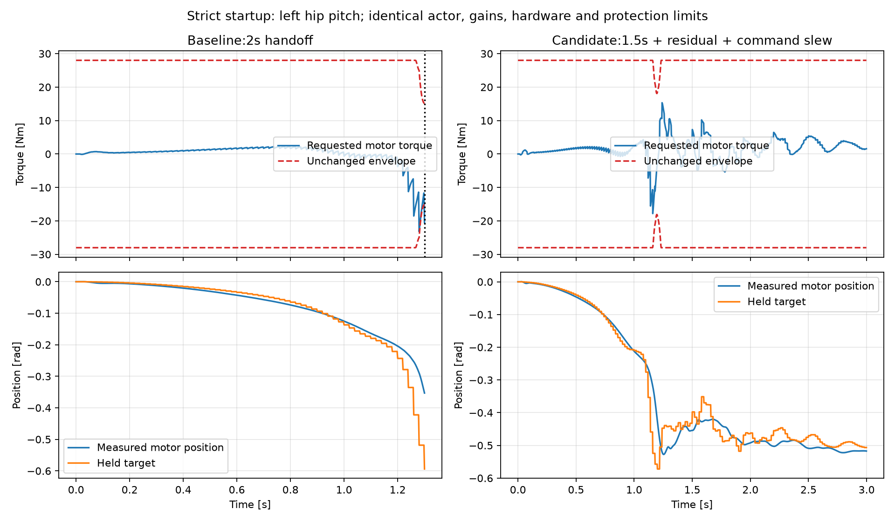

# OpenSprite-SuperMimic

面向 **Open Sprite v5（四肩 J4340P、2026-11-05 腰部惯量修订）** 的联合 SuperMimic 实验。
从原生机器人参考动作学习动作跟踪与速度命令接口，再通过原生 CPU 回放和电机空间闭环验证。

代码采用仓库原有的 **AGPL-3.0**。这不是 G1 论文成绩的复刻，也不是已经可直接上真机的控制器。

## 当前成果：run002 / 2026-11-06

| 阶段 | 已完成的结果 | 范围 |
|---|---|---|
| 联合训练 | L40S 48GB，12 小时，15398 次更新，从随机权重开始 | 4096 环境，FP32，TF32 关闭 |
| 训练环境评估 | 60/60 次速度测试，每次 30 秒；4/4 段连续测试，每段 62 秒 | 原训练串联关节执行器；非真机 |
| 动作跟踪评估 | 15/15 次，每次约 7.98 秒 | 五段原生参考、三个种子 |
| Jetson CPU | 14 组 / 21000 帧回放通过；双线程服务 P99 6.889 ms | 50 Hz，3000 周期，0 截止期遗漏；不含真实传感器/CAN |
| 严格电机闭环候选 | **88/88 次，每次 50 秒**；无原始力矩饱和、速度超限或前馈字段越界 | 1.5 s 交接、残余阻尼、命令斜率限制、明确的保守命令集 |
| 真机零增益 / 带电行走 | **未进行 / 未准入** | 电机发送和使能均为 0 |

**两种仿真的结论不能混用。** 训练环境中测试过前进 0.6 m/s；严格电机闭环目前只验证到
前进请求 0.25 m/s 及明确的转弯、倒退、横移场景。请求速度不等于实际速度；后者仍有偏差和漂移。
原配置 1.30 秒的启动保护事件仍可精确复现，没有放宽保护。



## 从哪里开始

- [安装、训练和评估](docs/REPRODUCE.md)：固定版本、500 Hz PD、预检、短训练、完整训练与导出。
- [如何获得重定向动作](docs/REFERENCE_MOTIONS.md)：源动作、UMR、接触优化及 QA；数据仅在本地使用。
- [CPU 回放与严格闭环](docs/RUNTIME.md)：10 帧 / 993 维接口、native 构建、仿真复现和 Jetson 时延。
- [结果与经验](docs/RESULTS_AND_LESSONS.md)：已有证据、失败消融、速度偏差和后续工作。
- [数据与第三方声明](DATA_AND_LICENSES.md)：代码许可证与外部数据条款分别记录。
- [Release](https://github.com/BeijingDynamics/OpenSprite-SuperMimic/releases)：训练检查点、ONNX、场景和验证成果，附 SHA256。

下载模型后，不需要参考动作即可使用 CPU 速度接口和严格电机闭环工具。
重新训练、原始动作跟踪评估和基于原参考初态的 GPU 评估，需要在本地另行准备参考动作。

## 固定的训练契约

- 机器人版本：`sprite0825_v5_4340_shoulders_waist20261105`，31 自由度，腰部 yaw link 质量 3.7391 kg。
- 全套发布 Kp/Kd、力矩上限和默认姿态按关节名绑定；训练 **500 Hz PD / 50 Hz 策略 / 10 子步**。
  上游控制快照的原始 200 Hz 元数据保留，500 Hz 覆盖在实验配置中明确记录。
- 完整联合方法：独立动作/速度编码器与价值网络，共享解码器和世界模型，环境 50/50 分配，
  10 帧历史、10 帧未来参考、参考/随机速度采样与潜变量对齐；不是 PPO 或单独速度策略。
- 训练配置：[configs/run002.json](configs/run002.json)；资产、源码与依赖身份见 [provenance/](provenance/)。

| 成果 | SHA256 |
|---|---|
| `model_015398.pt` | `094b52267159d26f4d5bfb41edc5823a9becc32f706c87df05f8aa36b4016282` |
| `policy.onnx` | `f3529c927a44f970908d48e5694e63302d0fc838121aba2fa87c0a0863968bba` |
| 发布控制快照 | `184ec989fd24b4bc6ea5034e6fdae796b5b9ce83ef2c884dfe4fc61d8d6987dc` |

## 仓库结构

```text
opensprite_tracker/supermimic/  世界模型、双接口、BPTT、回放与仿真
scripts/                       训练、评估、导出、动作处理与质量检查
configs/                       run002、评估命令、UMR 与冻结硬件仿真配置
upstream_asset/                固定 URDF/MJCF/控制快照；网格按哈希下载
retarget/ + third_party/umr/   UMR 适配及接触优化源码，保留第三方许可证
data/                          来源、片段选择与 QA 元数据；不含动作序列
runtime/                       验证过的 runtime 源码快照与测试
reports/                       数值结果与验证汇总
docs/                          复现步骤、经验及带日期的历史记录
```

本仓库与 [open_sprite](https://github.com/BeijingDynamics/open_sprite) 的模型仓库、
[open_sprite_runtime](https://github.com/BeijingDynamics/open_sprite_runtime) 的真机 runtime 各有职责。
runtime 快照固定于 `5f8225c`，方便独立复现；安装它不会替换机器人上的当前部署。

## 来源

训练实现基于 [lzjever/opensprite-tracker](https://github.com/lzjever/opensprite-tracker)
的固定版本及其 SuperMimic 实现，针对 v5、联合接口、参考动作与实际执行器差异继续开发。
方法参考 [SuperMimic](https://arxiv.org/abs/2610.28480)，重定向使用
[UMR](https://hanyang9.github.io/UMR/)，动作源为
[LAFAN1](https://github.com/ubisoft/ubisoft-laforge-animation-dataset)。
本仓库和 Release **均不分发 LAFAN1、重定向动作或参考动作录像**。
