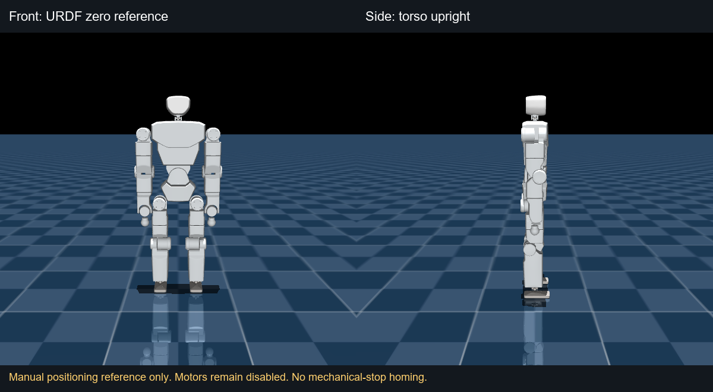

# 执行器时序、真实初态与启动审计

**训练已完成；本轮完整执行器压力准入未通过，电机没有使能。**
run002 的 12 小时主训练在 15398 次更新结束，权重、ONNX、资产和训练参数未修改。
训练 PD 仍为 500 Hz，策略 50 Hz。下面新增的是离线仿真实验和文件门禁，未激活新硬件控制器。

可核对的[数值报告](../reports/slot-schedule-audit/summary.json)保留通过与失败，
参数记录在[实验配置](../runtime/config/supermimic_run002_slot_audit.experiment.json)。
已有的 [88/88 严格启动仿真](SUPERMIMIC_STRICT_STARTUP_20261106.md)属于此前的时序模型；
不能用它代替本轮逐电机时隙、量化和真实初态的验证。

## 时序中发现的问题

上一轮真实输入只读 shadow 中，31 电机均以 500 Hz 零增益回复。
原控制调度则是踝部 500 Hz、多数其他电机 50 Hz，反馈年龄存在明显差别。
逐电机模拟原时隙后，陈旧反馈叠加推理预算会超过既有 30 ms 新鲜度限制。
真实 shadow 的 6.49 ms 服务 P99 并不包含完整的执行器闭环。

离线比较了以下实现，全部保留力矩、速度、位置与身体保护：

- 重复发送已保持的指令至 500 Hz，以提高反馈频率；策略目标和残余阻尼仍按 50 Hz 更新。
- 新目标到达后进入下一个控制时隙，避免再等待一轮独立 50 Hz 预览。
- 踝部在各自发送时隙前重算力矩，每个踝电机仍为 500 Hz。
- 对 MIT 位置、速度、增益、前馈与主机接收的位置/速度进行对应位宽量化。
  有符号字段的“零编码”有半个量化步长偏差，不能当作精确浮点零。

这些实现减少了等待，但仍未解决所有压力用例。只读链路可用不等于执行器控制已准入。

## 有界实验结果

| 组别 | 无保护触发 / 用例数 | 条件与结论 |
| --- | --- | --- |
| 到达触发预览，未加输出量化 | 25/28 ×50秒 | 0.25 m/s 前进、右转在较大采样余量下有失败 |
| 加输出量化，保守命令 | 22/24 ×50秒 | ±0.15 m/s、转弯等；右转在较大采样余量下失败 |
| 将转弯请求降至 ±0.10 rad/s | 6/8 ×50秒 | 仍有右转失败；仅缩小命令不能证明问题已解决 |
| 踝部发送前重算 | 6/8 ×50秒 | 改善部分用例，右转压力失败仍保留 |
| 再加反馈量化 | 2/4 ×50秒 | 两个左转通过，两个右转触发保护 |

全部 132 次时序/姿态/预定位实验的分组在数值报告中；另有原基线回归。
本轮主要使用 seed101、两个内部 PD 相位和明确的命令集，未完成新方案的广泛随机初态准入。

无保护触发也不代表准确跟随命令。在其中一个输出量化用例中：
前进请求 0.15 m/s，末5秒实际约 0.089 m/s，并有约 0.036 m/s 横向漂移；
倒退请求 -0.15 m/s，实际约 -0.076 m/s。
左右转在较小采样余量下方向正确，较大余量下右转有失败。
横移请求 -0.10 m/s 主要保持站立，不能把它算成横移能力通过。

### 压力假设与实测量必须分开

使用真实零增益 CAN 到达节奏，软件时间戳到单调时钟的换算采用明确的估计，
再加入 1/2 ms 内部采样年龄余量，按 0.5 ms 仿真步长保守取整。
该时间轨迹只在本地保存，不是测得的电机转矩响应。

另测 12 ms 目标延迟、8 ms IMU 延迟、8.607 ms 推理预算、5 ms 一阶转矩响应滞后，
以及建模的 1 kHz 内部 PD 两个相位。后两项尚未完成实机辨识，不能写成硬件测量结果。
训练频率没有从 500 Hz 改成 1 kHz。

悬空保持的延迟对照共 6 例：固定反馈延迟0/2ms分别配转矩滞后0/5ms均通过；
真实到达节奏加2ms采样余量、转矩滞后0ms也通过；同样节奏配5ms滞后则失败。
因此目前的压力失败不能直接推导为“训练模型已经坏了”，也不能通过选取有利滞后来宣布实机通过。
场景已经包含踝部 armature=0.0036，不能凭空再加惯量来获得稳定结果。

## 真实姿态与人工调整

原记录右膝位置为0.178721rad，超过软件硬上界0.175rad。
独立解码29964条原始CAN回复，位置码均为33236，与原生观测一致。
该上界来自冻结URDF的软件保护，未测量机械硬止挡；没有据此修改零位或放宽边界。

用户在电机未使能、吊架支撑下调整右膝与上肢，随后两轮10秒/500帧真实C++链路均通过。
位置/速度文件门禁转为通过。最后一轮左肩yaw约-5.9°、左腕yaw约+3.2°；
但腿部和躯干也随支撑状态改变，IMU读到约5.1°总倾角。
前一轮约3°的真实倾斜已由用户使用水平尺复核。未做姿态归零补偿；
每次仍保留正常的15秒陀螺静态偏置标定。
一次因不静止而在IMU标定阶段退出的负例已保存，当次CAN没有启动。

对照当前关节姿态/URDF零位与实测倾斜/竖直的8个15秒用例，仅“零位且竖直”的两个通过。
这是对启动初态敏感的证据，不是要求人工把31个未使能关节精确卡到零位。
继续盲目追零位会忽略支撑和重力改变，应先验证受支撑预定位与策略交接。



图仅用于机械朝向核对，不表示可由机械止挡找零。
若外形已吻合但编码器仍明显不符，应核对零位映射，不按数字强行扭转。

## 受支撑预定位仍是未通过的实验

离线试验将启动增益从最终发布值的0.1/0.2渐升至1，关节目标缓慢回到中立姿态，
再下降、卸载外部支撑并交给完整SuperMimic策略。
最终Kp/Kd和全部电机保护不变，运行在虚拟六自由度夹具下。
该夹具比吊绳更强，不能把它等同于真实吊架。

首批4例及减小高度、延长下降/卸载的4例全部触发保护，均未进入通过的无支撑评估。
接触统计表明，慢下降用例在触发前双脚仍未承重，故问题包括悬空踝的延迟敏感性，
并非仅靠放慢落地就能解决。报告保存实际失效时刻；计划中的释放后时长不算成功运行时长。
虚拟夹具释放后外力严格为零，有独立单元测试，但这不能使失败用例转为通过。

本轮没有向机器人部署启动增益爬坡、非零目标或残余阻尼执行。

## 验证和复现

- C++文件门禁 `sprite_supermimic_pose_gate`：冻结31电机位置/速度边界，197项用例通过，
  包括每个边界与超出一个浮点ULP、错顺序、损坏、截断和非有限值。
  它只检查记录文件，`admitted`仅指位置/速度，不能作为使能许可。
- 5项原生CTest通过；Linux unittest 326项，324通过、2项因Jetson未装可选MuJoCo跳过。
  对应MuJoCo项及新增调度/夹具测试在本地匹配版本环境通过。
  Windows整套SocketCAN测试因平台API不适用而失败的记录也保留，完整回归以Linux结果为准。
- 原始启动基线仍在1.30秒由同一电机触发同一保护。
  Windows与原Linux报告最大数值差约7.5e-14，未改变保护阈值。
- 两次人工调整采集的C++离线输出逐字节一致；独立Python的观测、原始动作、交接动作、目标误差均为0。

仿真使用与场景匹配的 MuJoCo3.11.0、CPU ORT1.23.2；不要用其他版本强读二进制MJB。
准备私有记录的时间轨迹：

```bash
PYTHONPATH=runtime/src python runtime/tools/prepare_recorded_feedback_timing.py \
  --capture /private/live-stress-60s --output /private/new-timing.npz \
  --seconds 50 --sample-margin-ms 2
```

常规复现实验入口：

```bash
PYTHONPATH=runtime/src python runtime/tools/simulate_supermimic_drives.py \
  --contract /private/bundle/contract.json --hardware /private/hardware.json \
  --scene /private/training-scene.mjb --commands /private/commands.json \
  --output-dir /private/new-output --modes slot_fresh_ankle_strict \
  --seconds 50 --workers 4 --seeds 101 --handoff --handoff-seconds 1.5 \
  --damping-compensation --command-linear-accel 0.25 --command-yaw-accel 0.3 \
  --delay-ms 12 --feedback-ms 0 --lag-ms 5 --imu-delay-ms 8 \
  --inference-budget-ms 8.607 --feedback-timing-trace /private/new-timing.npz \
  --wire-quantization --feedback-quantization --internal-phase 0
```

`commands.json`沿用既有的`[{"name":"stand","command":[0,0,0]}]`等格式。
可选`--initial-state`只接受通过冻结硬限位的虚拟初态。
`--supported-preposition`等开关只用于上述失败的夹具实验，不是推荐硬件启动入口。
原来的88例配方和默认仿真模式保持不变。

## 本地保存与下一关

真实CAN/IMU原始记录、由其生成的时间轨迹、参考/重定向数据仅在本地保存。
公开仓库只包含源码、参数、数值汇总和中立姿态参考图。
两轮新实测归档分别验证29/40个文件，后者包含不静止标定负例。

2026-11-06复核租赁机22项关键训练产物与本地SHA一致，私有参考归档也已验证。
租赁到期时间为2026-11-07 16:00（中国时间），不依赖继续租用GPU完成上述CPU调试。

下一关需要区分真实执行器响应、采样抖动和启动控制的影响，再验证可行的受支撑交接。
当前所有带电运动准入仍为false；不通过放宽保护、姿态归零或隐藏失败来获得通过结果。
